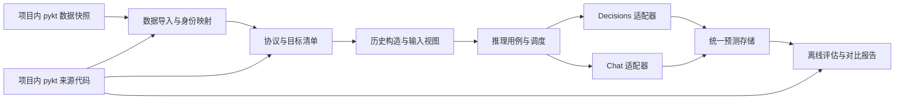

# 大模型 KT 独立项目设计方案

状态：方案阶段，尚未实现。日期：2026-10-17。

项目目录：`D:/1017KT/llm-kt`。项目使用 Python，围绕知识追踪的样本构建、远程模型推理和离线评估组织代码。本文是后续实现的设计依据；目录树、接口、配置和命令均为拟议设计，不表示已经存在。

## 1. 目标与范围

建立一个可独立运行的大模型知识追踪项目：复用个人分支 pykt 的数据协议和必要代码，支持通过配置切换决策模型与普通生成式大模型，对相同学生、相同预测目标和相同历史信息输出答对概率，再统一计算整体和学生级指标。

首期完成文本输入、逐步预测、OpenRouter Decisions API 与 Chat Completions API、缓存与断点续跑、标准评估及历史口径复现。模型权重训练、多模态输入、本地模型部署、多步闭环预测留作后续扩展，不作为首期交付条件。

独立性的要求是：移动或移除原 `pykt-toolkit` 目录后，本项目仍能加载已经导入的数据、构造样本、调用模型及评估结果。实现时凡实际用到的 pykt 代码、配置片段、映射和数据，都复制到本项目并登记来源；不通过 `sys.path`、可编辑安装、软链接或运行时读取相邻仓库形成隐性依赖。

核心研究目标是预测学生表现，不是让模型自行解题。输入只有离散题目/知识点 ID 时，明确告诉模型这些是标识符。若加入题干、知识点名称或难度统计，作为独立的输入条件记录，不能把它与仅使用 ID 的实验混为一组。

## 2. 任务协议先于接口实现

对学生 u 的第 t 次作答，构造历史 `H(u,t)` 和当前题目信息 `X(u,t)`，模型输出 `p_correct`。真实标签 `y_true` 单独存储，不能交给模型适配器。

标准首期任务采用逐步预测：预测当前交互只使用此前真实作答；当前预测完成后，后续目标可以观察已经发生的真实结果。模型不跨学生共享对话，不把未来作答放入上下文，不把一次请求中的多个待预测结果互相作为历史。

协议分为明确命名的几种模式：

| 协议 | 目标集合与历史 | 使用目的 |
|---|---|---|
| `pykt_segmented` | 严格遵循指定普通分段测试文件和 mask，每段首项不作为下一步目标 | 与普通分段基线对齐 |
| `pykt_window` | 遵循指定窗口文件和选择 mask，保留每个目标对应的实际窗口历史 | 与窗口基线对齐 |
| `full_prefix` | 从完整原始学生序列重建前缀，并按显式历史策略截断 | 独立的大模型 KT 实验，单独报告 |

评估层级另设 `question` 和 `concept`，不能与上述历史协议混淆。首期先实现选定数据集的题目级 `pykt_window` 对齐链路，再补普通分段和概念级。缺少题目 ID 的数据集可以使用概念目标，但必须在运行配置中声明。

数据集、fold、协议、评估层级、目标清单和历史策略共同定义一次实验任务。只更换模型配置时，这些内容保持不变。

### 2.1 多知识点与信息泄漏

同一次作答可能展开成多个概念交互。题目级样本构造必须把它们还原为一次作答，其所有目标概念共享同一份“本次作答之前”的历史，不能把同题其他展开项中的当前答案当作已知历史。

普通分段与题目专用测试序列不保证完全相同的历史或目标集合。导入器必须忠实保留实际协议；若输入文件本身包含同题展开的顺序信息，不能静默修正后继续声称与原路径等价。发现此类差异时输出对齐报告，并通过单独协议版本处理。

题目原生模型直接输出整题概率；概念模型可能先产生多个概念概率再做 `late_mean`。两者可以在同一题目目标集上比较，但预测方法需标注，不要求内部过程相同。

### 2.2 数据划分与历史特征

保留已有预处理文件中的学生划分和 fold，不重新随机切分。训练折可用于构造 few-shot 样例、题目历史正确率等可选特征；验证折用于提示词和参数选择；测试标签仅用于最终评估。

题目/知识点统计按当前训练折计算并版本化，不能从全部数据或测试标签计算。即使模型本身不训练，使用 few-shot、统计先验或校准器仍有训练/验证/测试边界。

## 3. 总体架构与依赖方向



采用单个 Python 包内的清晰模块边界，无需拆成多个服务。领域对象和接口不依赖 HTTP 客户端、DataFrame、供应商 SDK 或 CLI。应用层编排流程，基础设施层实现数据读写、API 和持久化，CLI 只负责读取配置并调用用例。

| 模块 | 内聚职责 | 不应承担的职责 |
|---|---|---|
| `domain` | 交互、目标、可见输入、预测、错误和协议的数据契约 | API 请求格式、文件路径 |
| `data` | CSV 导入、ID 映射、规范序列、输入校验 | 模型提示词、指标计算 |
| `protocols` | 确定目标、可见历史、切片和多概念分组 | 网络调度 |
| `prompts` | 相同语义输入的渲染、提示版本管理 | 读取标签、更新运行状态 |
| `providers` | API 请求与响应转换、能力声明 | 学生划分、AUC |
| `runtime` | 限流、重试、预算、缓存、恢复和任务状态 | 决定某题的真实答案 |
| `evaluation` | 预测校验、整体和学生级指标、同集对比 | 发起模型调用 |
| `storage` | 数据快照、运行清单、预测与原始响应保存 | KT 协议决策 |
| `application` | prepare、infer、evaluate、compare 用例编排 | 各供应商的解析细节 |
| `cli` | 参数、配置加载、用户输出 | 业务逻辑 |

依赖通过构造参数显式传入；用注册表从配置选择适配器与协议。避免在训练/评估主函数里堆积 `if model_name == ...`。配置分为数据、协议、输入、模型、执行、评估六类；使用强类型校验，未知字段报错。

## 4. 拟议目录结构

```text
llm-kt/
  docs/
    大模型KT独立项目设计方案.md
    pykt来源与改造清单.md                 # 实现阶段建立
    数据协议与指标定义.md                 # 实现阶段建立
  pyproject.toml
  README.md
  .env.example                           # 只有变量名与空值
  configs/
    datasets/
    protocols/
    models/
    experiments/
  src/llm_kt/
    domain/
    data/
    protocols/
    prompts/
    providers/
      base.py
      openrouter_decisions.py
      openai_compatible_chat.py
    runtime/
    evaluation/
    storage/
    application/
    cli.py
    vendor/pykt/                         # 自包含的来源代码及适配代码
  third_party/pykt/
    LICENSE
    provenance.json
  data/
    snapshots/<dataset>/<snapshot_id>/
    prepared/<dataset>/<task_id>/
  runs/<run_id>/
  tests/
    fixtures/
    unit/
    integration/
```

业务代码只有通过窄接口调用 `vendor/pykt`，其他模块不散落上游实现细节。运行产物、真实密钥和大数据快照不提交版本库。测试夹具使用合成小数据。

## 5. 从 pykt 复制什么，如何保证脱离原仓库

来源仓库为 `https://github.com/brothore/pykt-toolkit`，基准提交为 `a0cc4151f0b8c740b60c1cb18a070c8885baa9a6`。不能只复制一个函数而遗漏它依赖的常量、辅助函数或隐式约定。

| 来源 | 拟复用内容 | 项目内处理 |
|---|---|---|
| `configs/data_config.json` | 被选数据集的文件协议、长度和维度元数据 | 复制条目，改为项目内路径，不引用原仓库 |
| `pykt/preprocess/split_datasets.py` | 分段、窗口、qidx、重复项及题目展开相关函数与依赖 | 复制实际需要的函数依赖闭包；隔离文件写入副作用 |
| `pykt/preprocess/split_datasets_que.py` | 题目级知识点集合解析所需规则、生成函数 | 按需复制，明确与概念级的映射差异 |
| `pykt/datasets/data_loader.py`、`que_data_loader.py` | 移位、mask、字段解释规则 | 必要代码复制后抽成纯 Python/NumPy 适配，不复制整套训练导入链 |
| `pykt/models/evaluate_model.py` | 必要的题目融合与旧精度规则 | 复制需要的函数并移除模型隐藏状态和 Torch 依赖；标准概率保持原精度 |
| `examples/cal_unbalance.py` | 历史学生统计、二次滑窗、Gini/EAWI 逻辑 | 复制进明确命名的历史评估模块，标准评估另写 |
| `LICENSE` | 来源许可文本 | 保留 MIT 许可及版权说明，修改代码保留来源说明 |
| 选定数据文件、映射文件 | 训练/验证/测试协议及身份映射 | 一次性导入为本项目快照，记录文件哈希 |

初期优先导入已经预处理的 CSV，避免为 API 推理引入原仓库全部原始数据清洗和训练依赖。若后续启用某个原始数据集处理器，其调用到的 pykt 代码也必须一起复制并登记。

`provenance.json` 对每份代码记录上游路径、提交、原文件 SHA-256、复制日期、本地路径、所复制函数和修改摘要；对数据另记来源、许可或使用限制、文件哈希和导入参数。上游更新通过显式迁移完成，不自动覆盖。

复用代码不能直接带入 `pykt.models`、原 `init_dataset.py` 的全模型导入或上游全量依赖。首期目标依赖为 HTTP 客户端、配置校验、NumPy、Pandas、scikit-learn、YAML 和 CLI；不因解析 CSV 强制安装 Torch、CUDA 或 WandB。具体最低版本在实现时锁定。

## 6. 统一数据契约

### 6.1 规范交互与身份

`Interaction` 至少包含：`dataset_id、student_id、event_id、event_index、question_id（可空）、concept_ids、response、timestamp（可空）`。一次真实作答对应一个稳定 `event_id`；同一题目被同一学生重复作答必须得到不同事件 ID。

保存外部 UID、上游映射 UID、CSV 原始行索引与本项目 student_id 的显式映射。原 `orirow` 在不同输出路径中可能表示 UID 或原始行号，不能直接作为通用学生主键。

完整序列和窗口文件之间通过映射、事件顺序、qidx/cidx 等可用元数据建立关联。禁止仅凭题目 ID 去重；禁止把“已输出预测计数”当作原始事件位置。出现无法唯一映射的重复作答时，导入阶段失败并给出歧义位置，不能猜测匹配。

### 6.2 预测目标与模型可见输入分离

`TargetRecord` 保存 `sample_id、student_id、event_id、protocol_id、representation、history_boundary、y_true`，供样本对齐和评估使用。

`ModelInput` 只包含 `sample_id、history、current_item、allowed_features、input_version`，不含当前与未来标签。历史由协议层构造，不由模型供应商决定。日志和完整标签对象也不能被整体序列化为请求。

`sample_id` 根据数据快照、协议版本、学生、目标事件和表示层级生成，与模型名称无关；概念级目标另外包含 concept_id。相同任务切换模型后 sample_id 不变。

`Prediction` 包含 `sample_id、p_correct、probability_source、model_requested、model_returned、provider、request_id、status、attempt_count、latency_ms、usage、cost、request_hash`。失败结果的概率为空，不伪造为 0.5。

### 6.3 输入信息的公平性

首期统一使用结构化历史列表，每条列出匿名题目 ID、知识点集合和过去作答结果；当前题目单独列出。两类 API 使用相同的输入事实，允许不同的接口包装。

历史策略记录最近多少次真实作答、是否保留分段边界、排序、序列化和 token 截断规则。严格 pykt 对齐模式中超出模型上下文时应报错或更换容量合适的模型；不能只为某个模型静默缩短历史。另行做短历史实验时重新生成任务版本。

few-shot、题目难度先验、自然语言描述均作为可选特征插件；默认关闭，启用时记录来源与哈希。目标标签、未来统计和由测试集聚合得到的正确率不进入特征。

## 7. 模型接口设计

领域接口采用 `Predictor`：接收一个或一组 `ModelInput`，异步返回一一对应的 `Prediction`。可另有 `capabilities()` 描述是否支持决策原语、JSON Schema、推理参数、上下文上限及批量语义。

HTTP 传输、供应商响应解析、概率提取三者分层。网络异常转成统一错误；供应商专用字段保留在附属元数据中。评估层只消费 `p_correct` 与有效状态，不认识 `answers` 或 `choices`。

### 7.1 OpenRouter 决策适配器

按用户提供的 HTTP 示例，使用 `POST https://openrouter.ai/api/alpha/decisions`，鉴权为环境变量 `OPENROUTER_API_KEY` 对应的 Bearer token。首个模型配置为 `typesafe/jev-1.14`，不使用会自动漂移的 latest 别名作为正式实验标识。端点及模型可配置。[OpenRouter Jev 文档](https://openrouter.ai/docs/guides/community/jev)

拟议请求形状：

```json
{
  "model": "typesafe/jev-1.14",
  "state": {
    "history": [{"question_id": "q1", "concept_ids": ["c1"], "correct": true}],
    "current_item": {"question_id": "q2", "concept_ids": ["c1"]}
  },
  "questions": {
    "will_answer_correctly": {
      "type": "noul",
      "instructions": "Based only on the observed student history and current item, will this student answer the current item correctly?",
      "criteria": {
        "true": "The student answers the current item correctly",
        "false": "The student answers the current item incorrectly"
      }
    }
  }
}
```

从 `answers.will_answer_correctly.noul` 读取概率，校验类型、有限性与 `[0,1]` 范围。这个概率是研究中的预测分数，其在 KT 数据上的校准程度需要通过指标验证。

替换为其他决策模型时，若同样支持 Noul 和相同响应契约，只改配置；若仅支持 Choice，则配置正负选项，并取“答对”选项概率。`confidence` 不等于答对概率，Score 也不能默认线性归一化为答对概率。缺少可解释的概率契约时标记为不兼容，新增有版本的提取策略后再使用。

Python HTTP 请求直接传 `model/state/questions`。用户示例中的 `decisionsRequest` 属于特定 SDK 的调用包装，不能误放进 HTTP JSON。所有 endpoint、headers 与响应契约将在实现阶段以官方文档和小额接口验证确认。

### 7.2 普通大模型适配器

使用 OpenAI 兼容的 `POST /chat/completions`；OpenRouter 完整地址为 `https://openrouter.ai/api/v1/chat/completions`。按 `base_url、model、api_key_env` 切换供应商；兼容性由能力检查确认，不能只凭 URL 相似就认为支持所有参数。[官方 Chat API](https://openrouter.ai/docs/api/api-reference/chat/create-a-chat-completion)

消息包含任务说明和同一份 `ModelInput`。要求模型给出当前学生答对概率，首选受约束 JSON：

```json
{"p_correct": 0.73}
```

支持 JSON Schema 的模型使用严格 schema；不支持时使用 JSON 模式或明确的 JSON 提示并严格解析。配置选择策略，能力不匹配时在运行前报错，不静默降级。[结构化输出文档](https://openrouter.ai/docs/guides/features/structured-outputs)

普通模型返回的数值属于模型自报的概率估计，应记录 `probability_source=verbalized_probability`；它与决策模型原生概率的含义和校准表现可能不同，但可以作为连续分数统一评估。不能把“预测为正确”的置信度直接当成正类概率。

若未来支持基于标签 token 的 logprob 提取，独立作为策略，检查 tokenization、候选覆盖及多 token 标签，不能只对残缺的 top-logprobs 随意归一化。首期不依赖该策略。

`reasoning`、温度、seed、最大输出长度均属于模型配置；只向支持这些参数的后端发送。首期每个目标独立请求，无需累积对话或回传前一题的 reasoning_details；如后续加入多轮，按供应商契约保存必要响应字段。只解析最终答案，不从 reasoning 文本抽取概率。

拒答、截断、空响应、NaN、范围外数值和无效 JSON 都是失败状态。不采用“取文本中第一个数字”、静默裁剪概率或自动补 0.5。格式修复如需启用，应有明确次数上限、独立记录其费用和策略版本。

## 8. 配置方式与扩展规则

拟议实验配置示意：

```yaml
dataset:
  snapshot: assist2009_v1
  validation_fold: 0
task:
  protocol: pykt_window
  level: question
  target_manifest: data/prepared/assist2009/task_v1/targets.jsonl
input:
  template: history_ids_v1
  history_policy: protocol_exact
model:
  adapter: openrouter_decisions
  model_id: typesafe/jev-1.14
  endpoint: https://openrouter.ai/api/alpha/decisions
  api_key_env: OPENROUTER_API_KEY
  probability_strategy: noul
execution:
  max_concurrency: 4
  max_attempts: 3
  timeout_seconds: 60
  budget_usd: 5.0
  cache_policy: resume
evaluation:
  profile: standard_v1
  student_std_ddof: 1
  threshold: 0.5
```

该预算和并发仅为示意，不代表模型价格或限制。Chat 配置切换 `adapter、model_id、endpoint、probability_strategy` 及其能力参数；任务与目标清单不变。运行前将所有默认值解析为完整配置，写入 run manifest 并计算哈希。

扩展一种同协议模型只新增配置；新增 API 协议新增适配器；新增数据格式新增导入器；新增历史策略新增协议实现；新增指标只修改评估模块。新增功能不要求修改其他供应商代码。

## 9. 调度、缓存、断点与费用

使用异步 HTTP 客户端和有界工作队列，按供应商/模型独立配置并发、请求速率及 token 配额。首期一个目标对应一个请求；不同目标并发处理。避免把同一学生整段含未来答案的序列合并进一个共享 state。

重试限于可恢复的超时、连接问题、429 和部分 5xx；遵循 Retry-After，采用带抖动的退避。401/403、无效模型、schema 错误等停止相应任务并报告。最大尝试次数包含首次请求。重试只由 runtime 统一负责，避免客户端与调度器叠加重试。

缓存键包含数据与协议哈希、精确 ModelInput、模板版本、adapter 版本、endpoint、模型标识、推理参数、概率提取策略及供应商路由配置。密钥不进入缓存键或日志。缓存命中返回原始结果，不伪装成新的独立重复实验。

`resume` 只补缺失或可重试任务；`replicate_id` 区分主动重复推理。低温或固定 seed 不能被描述为远程 API 的严格确定性保证。模型别名或供应商后台更新可能改变结果，manifest 保存实际返回模型、供应商和调用时间。

采用 SQLite 保存任务状态、请求哈希和成功预测，唯一约束避免并发重复落库；原始响应按 request_id 保存后导出 JSONL/CSV。崩溃恢复将过期 running 状态重新排队。网络请求在服务端成功但本地未记录时可能被重试，不能承诺供应商端恰好执行一次或恰好计费一次。

预算在派发前按可获得的价格与 token 估计保守预留，响应后按可获得的 usage/cost 结算；无法获取价格时标记估算未知并使用请求数或 token 上限。供应商计费数据缺失时不记为 0；在途请求可能让最终费用超出估算，应在报告中列出预留、已知费用与未知费用。额度不足时停止新派发，保留已完成结果。

## 10. 评估口径与结果比较

### 10.1 默认标准口径 standard_v1

每个目标只计一次，概率保留原始精度。只接收成功、有限、在 `[0,1]` 内且与标签一一对齐的预测；缺失、重复或身份冲突应显式报告，禁止截断到相同长度掩盖对齐错误。

输出指标：

- 全体有效目标的 ROC-AUC、ACC、LogLoss、Brier score；阈值由配置指定，默认 0.5。
- 每学生 AUC、目标数、正负标签数、ACC、LogLoss 和 Brier score。
- 学生 AUC mean、std（默认 `ddof=1`）、median、min/max、range、Q1/Q3/IQR。
- 总目标数、成功数、失败数、预测覆盖率；总学生数、有效 AUC 学生数和学生 AUC 覆盖率。
- 推理延迟分位数、token 用量、已知费用、未知费用数量和缓存命中数。

单类或无有效预测的学生，AUC 为 null，并给出原因；mean/std 只对可计算学生汇总。只有一名有效学生时样本 std 为 null，少于一名时 mean 也为 null。整体只含一类时整体 AUC 同样为 null。LogLoss 仅在公式内部用明确 epsilon 防止 log(0)，不改变保存的概率。

### 10.2 历史复现口径 pykt_legacy_v1

独立模块复现原学生统计脚本：二次滑窗汇集（窗口 200）、单类赋值 0.5、样本标准差及 Gini/EAWI 等。若复现涉及上游舍入和不同保存路径，配置中同时指定来源路径与精度规则。

标准结果和历史结果写入不同文件与字段命名空间，不把后处理滑窗加权后的整体 AUC 当成唯一目标集上的整体 AUC。历史函数中的虚拟点策略等只在确实对应的复现路径启用，不扩散到标准评估。

### 10.3 多模型公平比较

`compare` 首先检查 dataset/task/input 哈希和目标 sample_id 集合。正式完整比较要求目标全部成功；部分完成时同时报告各模型覆盖率，并只在共同成功目标上输出明确标注的探索性对比。共同学生的 AUC 仍需重新检查正负标签是否齐全。

按学生差异分析时保存配对的学生 AUC 和差值；可选采用学生为抽样单位的 bootstrap，避免把同一学生交互当成独立样本。跨 fold、跨重复推理的 mean/std 与学生间 mean/std 分开输出。禁止按模型各自容易成功的子集直接排名。

已有 pykt 基线文件通过单独的结果导入器映射到 sample_id。若仅有累加计数且无法恢复真实目标身份，只能提供有限的汇总参考，不能声称完成逐样本对齐；优先重新导出含稳定事件身份的预测。

## 11. 运行产物与可复现性

每个 `runs/<run_id>` 计划包含：

| 文件 | 内容 |
|---|---|
| `manifest.json` | 完整配置、代码版本、数据/协议/模板哈希、运行时间、能力快照 |
| `task_summary.json` | 学生与目标数量、排除原因、输入历史分布、身份校验 |
| `state.sqlite` | 调度状态、尝试记录、预测与缓存引用 |
| `requests/`、`responses/` | 脱敏后的请求与原始响应，关联 request_id |
| `predictions.jsonl` | 独立于供应商的统一预测 |
| `predictions.csv` | 方便人工分析的扁平表 |
| `per_student.csv` | 每学生指标和可计算性原因 |
| `metrics_standard.json` | 标准指标及覆盖率 |
| `metrics_legacy.json` | 可选的历史复现指标 |
| `failures.jsonl` | 失败类别、目标与重试信息 |
| `report.md` | 协议、表现、覆盖率、成本和限制 |

目标标签与模型请求在存储上分开，评估阶段按 sample_id 合并。请求只发送匿名学生标识或不发送身份；日志不得记录 Authorization。配置保存密钥环境变量名，不保存值。请求和响应可能包含学习记录，作为本地实验数据管理。

## 12. 拟议操作流程

CLI 采用 `llm-kt`，后续按以下顺序实现：

1. `import-pykt`：将所选数据、配置和映射复制为本项目快照，验证哈希与学生划分。
2. `prepare`：生成规范交互、稳定目标清单、无标签 ModelInput 和对齐报告。
3. `validate`：离线校验配置、能力要求、目标身份和上下文预算，不发付费请求。
4. `infer --dry-run`：展示少量脱敏请求、估算请求数与 token；不调用模型。
5. `infer`：按预算执行，保存成功/失败与原始响应。
6. `resume`：基于相同 manifest 补齐未完成任务。
7. `evaluate`：只读取本地预测和标签，重新计算指定口径。
8. `compare`：核对任务一致性，输出多模型报告。

离线准备、推理与指标计算相互独立。修改指标不重新调用 API；修改模型不重新随机划分；修改输入会生成新版本而非覆盖旧结果。

## 13. 验证与验收标准

测试围绕研究正确性和运行恢复能力，而非只测试函数能否返回对象。

| 重点 | 验收要求 |
|---|---|
| 未来信息隔离 | 改变当前标签及未来所有响应，当前目标 ModelInput 和请求哈希不变 |
| 历史敏感性 | 改变已允许观察的历史响应，相关后续目标输入随之变化 |
| 多概念作答 | 当前作答答案不通过同题其他展开项进入历史，题目目标只计一次 |
| pykt 对齐 | 合成序列在长度 2/3/199/200/201/400 边界上的片段、mask、目标和窗口与复制来源一致 |
| 稳定身份 | 同学生重复同题、跨片段、跨窗口及不同批次仍对应正确 event_id |
| 概率解析 | 两种适配器的模拟响应产生相同领域结果；无效响应必定失败 |
| 指标 | 手工可核验数据上的整体/学生 AUC、单类处理、ddof、二次滑窗和舍入均有固定参考 |
| 恢复 | 模拟 429、超时和落盘前后中断，恢复后成功预测无重复、失败可追踪 |
| 预算 | 达到限制后停止新派发；已有结果可继续评估 |
| 独立运行 | 原仓库不在模块搜索路径且不可访问时，所有离线测试及模拟推理仍通过 |
| 更换模型 | 同协议模型仅换配置；两种 API 用相同目标清单输出统一预测文件 |

真实 API 验证采用明确上限的小样本，确认 Decisions 与 Chat 的实际响应契约、模型能力及 usage 字段，不在单元测试中触发网络或付费调用。

## 14. 实现阶段与交付顺序

**阶段一：独立骨架与数据协议。** 建立包结构，复制所需上游代码和许可，导入一个指定数据集快照，实现稳定身份、目标清单及无标签输入。交付对齐报告和离线边界测试。当前本地 pykt 尚无可直接训练的各数据集子目录，`peiyou(1).zip` 的内容也未检查，不能预先视为可用数据快照。

**阶段二：两类模型适配与最小闭环。** 实现 Decisions Noul 和 Chat JSON 概率，使用同一批合成及小样本输入验证统一预测契约。正式实验前确认数据集、实际可用模型、上下文和预算。

**阶段三：可靠执行。** 实现限流、预算、SQLite 状态、请求记录、缓存和恢复，验证中断与失败场景。

**阶段四：评估与基线对齐。** 实现标准及历史两套口径、逐学生统计和共同样本比较；导入已有基线或重新取得可对齐预测，输出报告。

**阶段五：实验扩展。** 在已验证的数据链路上增加其他模型配置、few-shot、统计特征、不同历史长度与其他数据集；每次扩展以配置或单一插件为主。

进入实现时仍需明确：首个数据集及可用数据路径、首个对照大模型、调用预算。设计阶段不需要密钥，也不对真实接口发起推理请求。

## 15. 参考依据

- 用户提供的 Decisions 与 Chat HTTP/SDK 示例，以及附件中的 OpenRouter 示例；方案将 SDK 参数包装与 HTTP 请求体分开处理。
- 本地 pykt 基准代码和 `docs/pyKT框架运转流程与KT任务指南.md`；上游代码与数据在实现阶段按第 5 节复制进项目。
- [OpenRouter Jev / Decisions 接入说明](https://openrouter.ai/docs/guides/community/jev)：决策端点、模型与原语。
- [OpenRouter Chat Completions API](https://openrouter.ai/docs/api/api-reference/chat/create-a-chat-completion)：普通模型请求入口。
- [OpenRouter Structured Outputs](https://openrouter.ai/docs/guides/features/structured-outputs)：受约束 JSON 输出及模型能力要求。

接口信息于 2026-10-17 核对。模型可用性、支持参数及计费在实现和正式实验前重新确认，运行时保存实际信息。
